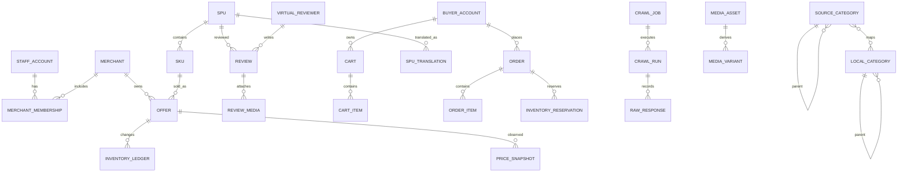

# 数据模型与文件存储

## 1. 核心关系



## 2. 标识规则

- 本地业务主键使用 bigint 或 UUIDv7，具体在实现前统一确定；
- 对外 API 使用不可枚举的 public ID；
- 每个来源对象保存 `source_system`、`source_id`、`source_url`；
- 同一 Joybuy `source_id` 直接更新，不创建重复业务实体；
- 跨链接/跨来源仅在 GTIN/EAN、品牌、型号和规格高度一致时自动关联；
- 标题相似度只产生人工审核建议，不自动合并。

## 3. 商品模型

### 3.1 SPU

- 品牌、标准编码、通用属性；
- 来源状态和本地状态；
- 来源类目和本地类目；
- 标题、卖点和详情放入 locale 内容表；
- 来源内容按 `market + requested_locale` 保存，并逐字段记录实际内容语言、源哈希和观察时间；默认原样复刻 Joybuy 的混合语言，不强制机器翻译；完整方案见 [多语言商品内容与国家市场设计](./10-multilingual-content-and-market-design.md)；
- 当前评分、评价数、已展示销量等只保存来源明确值；
- 来源值、本地覆盖值和最终有效值可追溯。

### 3.2 SKU

- 颜色、尺寸、容量等规格组合；
- 来源 SKU ID、条码、重量、尺寸；
- SKU 图库；
- 规格组合唯一约束。

### 3.3 Offer

- 商家、SKU、市场、币种；
- 当前售价、划线价、活动标签；
- 本地库存、上下架和可售状态；
- 抓取商品库存默认 `9999`，前台达到阈值显示 `999+`；
- 来源可售状态与本地库存分开。

## 4. 来源层、本地覆盖层与有效值

每个可编辑字段遵循：

```text
effective_value = approved_local_override ?? latest_source_value
```

- 爬虫只更新来源层；
- 平台人员在覆盖层编辑；
- 覆盖必须有审核状态、操作者、原因和版本；
- 清除覆盖后恢复跟随来源；
- 后台显示来源值与覆盖值差异；
- 来源消失时标记失效，不物理删除历史。

## 5. 类目与推荐

- `SourceCategory` 保存 Joybuy 类目树及版本；
- `LocalCategory` 保存本地导航和运营结构；
- `CategoryMapping` 建立多对多映射；
- 抓取任务绑定稳定的来源类目标识和快照版本；
- `RecommendationSnapshot` 保存场景、来源页面、商品顺序、抓取时间；
- 推荐商品缺失或下架时，以同类目热销商品补位；
- 不建设机器学习推荐模型。

## 6. 评价与虚拟用户

### 6.1 虚拟用户

- 本地 `VirtualReviewer` 使用 UUID；
- `source_fingerprint = HMAC-SHA256(secret, source_system + stable_public_identifier)`；
- 不保存可逆的来源内部用户标识；
- 仅保存公开的脱敏昵称、头像和展示属性；
- 没有稳定标识时，不以昵称相同判定为同一人；
- 虚拟评价用户不能登录，不与真实买家自动合并。

### 6.2 评价

- 来源评价与本站评价分开标记；
- 保存评分、正文、时间、规格、点赞数、来源位置和媒体；
- 内容哈希用于去重和版本判断；
- 来源删除后软删除并记录最后出现时间；
- 来源修改时保留版本；
- 图片下载后移除 EXIF；
- 默认全站目标 50 条/商品，任务可设 `1-300`；
- 真实评价不足时保存实际数量，允许个位数；
- 分层采样保持星级分布，兼顾近期和媒体评价。

## 7. 历史快照

价格、库存来源状态、评分、销量展示值和排名不得只覆盖当前值：

- 业务表保存当前值；
- 快照表保存观察时间和来源；
- 排名保存榜单/类目/关键词、名次和来源页面；
- 大型快照表按时间分区；
- 来源未展示的数据保持 `NULL`；
- 估算字段单独命名并标注算法版本。

## 8. 订单与库存

- `Cart` 与 `Order` 分离；加入购物车不创建订单；
- 提交结算时创建 Order 和 OrderItem；
- 订单创建与库存预占在同一数据库事务中；
- `InventoryReservation` 默认 60 分钟过期；
- 过期任务必须幂等释放库存；
- 库存使用流水表记录原因、数量、订单和操作者；
- 首期状态仅实际使用 `PENDING_PAYMENT` 和 `CANCELED`；
- 支付成功、履约子单和包裹模型只预留，不开放操作入口。

## 9. 媒体存储

### 9.1 生产物理根目录

```text
/srv/joybuy/data/
  media/
    products/original/{aa}/{bb}/{sha256}.{ext}
    products/derived/{preset}/{aa}/{bb}/{sha256}.{ext}
    reviews/original/{aa}/{bb}/{sha256}.{ext}
    reviews/derived/{preset}/{aa}/{bb}/{sha256}.{ext}
    cms/original/{aa}/{bb}/{sha256}.{ext}
    icons/{aa}/{bb}/{sha256}.{ext}
    fonts/{aa}/{bb}/{sha256}.{ext}
  raw/{yyyy}/{mm}/{dd}/{job_id}/...
  exports/...
  tmp/...
```

`aa`、`bb` 为哈希前两级分片，避免单目录文件过多。

### 9.2 URL

- Nginx 对外路径统一为 `/media/<relative_path>`；
- 数据库只存 `relative_path`；
- 不存 `/srv/...`、Windows 盘符或域名；
- 将来切换 MinIO/S3 时只替换存储后端和 URL 生成器。

### 9.3 媒体元数据

- SHA-256、MIME、扩展名、字节数；
- 宽高、时长、编码、帧率；
- 来源 URL、首次和最后抓取时间；
- 下载状态、处理状态、错误；
- 资产用途和关联对象；
- 原文件与衍生文件关系。

### 9.4 衍生文件

- 图片：保留原始文件，生成 WebP/AVIF 多尺寸版本；
- 视频：保留原始文件，生成封面和网页播放 MP4/HLS；
- 全局按内容哈希去重；
- 前端不得直接引用来源 CDN。

## 10. 原始响应

- HTML/JSON 压缩保存到 `raw/`；
- MySQL 保存路径、URL、状态码、响应哈希、任务和抓取时间；
- 默认保留 30 天；
- 到期后删除文件但保留必要的哈希、任务记录和规范化数据；
- 原始响应中若含会话或敏感字段，写盘前必须脱敏。

## 11. 容量与索引

设计上限：50 万 SPU、200 万 SKU/Offer、2,500 万评价。

关键索引：

- 来源系统 + 来源 ID 唯一索引；
- SPU/SKU/Offer 外键和状态组合索引；
- locale + business ID 唯一索引；
- 评价的 SPU + 状态 + 时间索引；
- 快照表的对象 + 观察时间索引并按月分区；
- 订单的买家 + 状态 + 创建时间索引；
- 任务的状态 + 优先级 + 计划时间索引。

任何大表查询都必须通过执行计划验证，禁止依赖无界 OFFSET 扫描。
