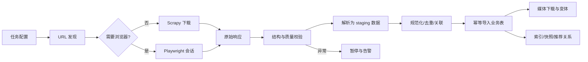

# 爬虫与数据导入

## 1. 目标

- 支持选择二级或三级类目后抓取该范围内商品；
- 支持设置商品条数、排序、评价目标数、市场和语言；
- 支持试点抓取、全站抓取、增量同步和完整刷新；
- 支持断点续爬、幂等导入、媒体下载和数据质量告警；
- 避免触发风控优先（真实浏览器环境、规范化指纹、低频抓取、复用会话）；【修订 2026-11-05】出现验证码/风控页时采用人工接管处理（见 7.3），不程序化打码、不伪造签名绕过接口校验。

## 2. 分阶段策略

1. 选择 3-5 个类目；
2. 每类抓取 50-100 个商品；
3. 验证字段、SKU、图片、评价、去重、增量和重放；
4. 通过质量闸门后逐步扩大类目；
5. 最后才运行全站任务。

全站模式默认每件商品目标 50 条评价；指定类目或商品可设 `1-300`。真实评价不足时只保存实际数据。

## 3. 抓取技术

- 优先调用页面实际使用、且授权允许访问的数据接口；
- Scrapy 负责 URL 队列、限速、缓存、重试、去重和下载；
- Playwright 仅用于必须执行 JavaScript、建立登录会话或完成管理员人工验证的页面；
- Celery 负责任务编排和状态；
- 浏览器 worker 与 HTTP worker 分开；
- 解析器按页面类型和结构版本组织；
- 导入使用 staging 表或导入服务，不直接在 spider 内散写业务表。
- **浏览器生命周期（2026-11-05 修正）**：一个任务只允许一个爬虫浏览器。类目抓取走
  `BrowserSession`（一次 open、翻多页、退出时 `quit()` + 进程回收）；Scrapy 风控/登录墙
  回退渲染在中间件里复用同一个 session，并在 `spider_closed` 关闭。每条兜底渲染都新开浏览器
  的实现会让一个任务堆出几十个 Chrome，已废弃。残留实例可用
  `manage.py close_crawler_browsers` 回收（只匹配爬虫 `user-data-dir` 与 9333/9334 调试端口，
  不会碰用户自己的 Chrome）。

## 4. 类目任务参数

> 2026-11-03 起的品类配额与树形选择改造，以
> [爬虫任务品类与配额页面改造方案](./09-crawler-category-task-redesign.md)
> 为最新设计基线。现有单类目参数保留用于历史任务兼容。

- 每次抓取必须显式保存 `source_locale`；后续中文类目分析使用 Joybuy 简体中文页面，英文现场结果只作历史参考；
- 每个实际支持的市场/语言组合独立抓取 Joybuy 页面并保存原样文本；德国页面出现德英混合时逐字段记录实际语言，不强制翻译，也不要求用户触发翻译；

管理端任务至少包含：

- 任务名称和优先级；
- 市场、语言、币种；
- 来源二级/三级类目；
- `仅当前类目` / `包含子类目`；
- 二级类目默认包含子类目，三级类目默认仅当前类目；
- 商品数量上限（新页面改名为“本任务最多成功入库商品数”，按去重且通过质量闸门的成功入库商品计数，不按请求数、页面数或发现链接数计数）；
- 排序：来源默认、销量、评分、新品、随机；
- 默认来源排序，并保存当时榜单位置；
- 模式：增量同步 / 完整刷新；
- 商品媒体与详情媒体的下载开关；
- 调度时间、并发、速率和账号组；
- 失败策略和是否允许人工恢复。

> 【停用：2026-11-05】评价目标数（原 `1-300`，默认 50）与"评价媒体下载"两项参数不再生效——爬虫停止采集评价内容，只采集评分聚合与 AI 摘要，见 §10。

随机抽样必须保存 seed，使重复任务可复现。

### 4.1 类目中文名对照（2026-11-05）

管理端【新建任务】的类目选择器同时显示「中文名 / English name」，两个名字按**来源 ID**
（`minihome:UK-Mini-HP-Electronics`、`l2:1405`）严格一对一，绝不按名称或位置匹配。

- **语言开关**：joybuy.co.uk 把界面语言存在 `_lang` Cookie（默认 `en_GB`）；设为 `zh_CN`
  后整个站点（含类目菜单与频道页类目磁贴）变中文，URL 与 source id 完全不变。
- **登录墙**：2026-11-05 起未登录访问首页/频道页会被 307 跳 `/login`，匿名抓取拿不到
  类目内容。抓取必须带已登录账号会话（`--account <账号 public_id>`）。
- **存储**：`SourceCategory.name_zh` 按 source id 持久保存，`SourceCategorySnapshot.name_zh`
  是版本内展示名；英文树仍是结构基线，重新同步英文树时中文名自动继承，不会丢。
- **命令**：

  ```bash
  # 全量抓取（14 个频道）+ 落库
  manage.py sync_joybuy_category_names_zh --account <id> \
      --dump-json var/joybuy_demo/data/category_menu_zh.json
  
  # 被限流时按频道分块抓取，多次运行自动合并
  manage.py sync_joybuy_category_names_zh --account <id> --merge-json \
      --dump-json var/joybuy_demo/data/category_menu_zh.json \
      --channel minihome:UK-Mini-HP-Toys-Baby-and-Kids --pause 20
  
  # 只回放已保存的抓取结果（无网络）
  manage.py sync_joybuy_category_names_zh --from-json <dump.json>
  ```

  命令会报告 `unknown`（抓到了树里没有的 id）与 `still_missing`（树里有但没抓到中文名）
  两类差异；`still_missing` 只影响展示（该节点仅显示英文名），不会伪造译名。

## 5. 增量与刷新

### 5.1 增量同步

- 发现新商品；
- 更新变化字段；
- 增量抓取新评价；
- 媒体 URL 或内容哈希变化时才重新下载；
- 已有商品不会因本次限量任务未出现而失效。

本地数据集（`var/crawl_exports/…`）的增量口径（2026-11-05 实现）：

- `product.json` 与图片**每次都重写**——原始快照永不丢失，解析错了只能靠当时真正抓到的那份数据回放；
- 每个商品目录额外写 `meta.json`（`payload_sha256`、`first_captured_at`、`last_captured_at`、`capture_count`、`changed`）；
- `dataset_index.jsonl` 只在内容指纹变化（或首次落盘）时追加一行，重复抓取同一商品不会把索引刷成重复行；
- 任务结束时写 `DATASET_SUMMARY` 事件，汇报刷新了多少目录、其中多少条内容真正发生变化。

### 5.2 完整刷新

- 重新遍历任务范围；
- 更新现有数据并新增商品；
- 本轮未出现的来源 Offer 标记为疑似失效；
- 经连续确认后改为失效，不直接物理删除；
- 不覆盖本地人工覆盖值。

## 6. 建议频率

- 价格与来源库存状态：每 6 小时；
- 商品基础信息：每日；
- 评价：每日增量；
- 类目与品牌：每周；
- 媒体：内容变化触发；
- 所有频率可在管理端调整。

## 7. 多账号与会话

### 7.1 安全存储

- 使用用户提供且有权使用的 Facebook 账号手动完成 Joybuy OAuth；
- 系统不收集或保存 Facebook 密码；
- 只保存加密后的 Joybuy 会话；
- 会话失效后由管理员重新手动登录；
- 凭据不进入普通配置文件、错误日志或任务导出。

### 7.2 调度规则

- 任一账号触发验证码/风控后立即移出队列；
- 被中断任务能自动切换其他账号接管；
- 短时间多个账号出现相同风险时全局熔断；

### 7.3 风控与验证码处理（2026-11-05 口径更新）

- **避免触发优先**：所有页面抓取优先走真实 Chrome（DrissionPage）而不是纯 HTTP；浏览器环境规范化——去除 Chromium 自动化特征（`AutomationControlled`）、UA 使用本机 Chrome 真实值（无头模式剥离 `HeadlessChrome` 标记）、独立专用 profile 复用登录态；
- 单浏览器低并发 + 页间延迟 + 429/403/5xx 指数退避（见第 8 节），不并发轰击；
- **人工接管**：仍出现验证码或风控页时，任务暂停并提示操作者在有头浏览器窗口中**本人完成**验证/登录；完成后爬虫在同一会话内继续，不重放已失败页面以外的请求；
- 不使用打码平台、不程序化识别或绕过验证码；不伪造签名、不破解加密参数绕过接口校验；
- 风控页绝不作为正常商品/列表页解析，即使人工验证后也要重新请求确认。

### 7.4 账号与任务绑定（2026-11-05 实现）

此前任务表只有 `account_group`（默认 `default`），建任务界面上没有任何账号入口，于是**每个任务都只会落到 default 组**；而且即使运行拿到了账号，也只有浏览器回退那一步带 Cookie，Scrapy 的普通 HTTP 请求是匿名的——每页都要先撞一次登录墙（307 → `/login`）再开浏览器重抓。

现行规则：

- 建任务时可**指定账号**（`CrawlJob.account`，迁移 `0006`）。不指定则按 `account_group` 自动挑「最近最少使用」的可用账号；
- 可用 = `status=ACTIVE` **且** `session_status=VALID` **且** 会话密文能解开 **且解出的载荷里真的含 Cookie**。最后一条是 2026-11-05 补的：历史上有账号被写成 `session_status=VALID`、但载荷只有一个占位字段 `{"joybuy_session": "..."}`，选中它等于"看起来已登录、实际匿名"，正是登录墙的直接原因。演示类管理命令（`load_joybuy_demo`、`load_uk_bestsellers_demo`）也因此不再伪造会话。
- 指定账号不可用时**不静默失败**：写 `ACCOUNT_FALLBACK`（WARNING）事件说明原因，再回退到组内自动选号；组内也没有则写 `RUN_UNAUTHENTICATED` 并匿名启动；
- 成功选到账号时写 `RUN_ACCOUNT_SELECTED`（INFO）事件，内容含账号名与账号组，**任务详情里能直接看到这轮用的是哪个身份**；
- 抓取侧由 `middlewares.AccountCookieMiddleware`（优先级 550，早于 Scrapy 的 CookiesMiddleware 700）把**当前活跃账号**的 Cookie 注入每一个请求，因此第一跳就是登录态；浏览器回退复用同一个账号的 Cookie；
- 只回放 `joybuy` 域 Cookie：第三方 Cookie（Facebook 等）绝不发给源站，避免把凭据泄露到别的域；
- 会话解密只发生在爬虫进程内（账号池构建时按账号各解一次，不跨进程、不落盘），密文始终留在库里，日志不打印 Cookie 值。

### 7.5 账号池轮换（2026-11-05 用户决定）

> 口径变更：一次抓取不再一路固定一个身份。用户在 2026-11-05 明确要求「利用多个账号不定时换号抓取」，原 §7.2「被中断任务不能自动切换其他账号接管」与 §8「不为提高吞吐量轮换账号」两条已按此调整。

**目标**：把一次抓取的请求量分摊到多个账号，让单个账号的请求密度更低，而不是提高总速率。

**池的构成**（`services.usable_accounts_for_run`）：

1. `CrawlJob.account` 指定的账号（若可用）排第一；
2. 其后是同 `account_group` 内 `ACTIVE` + `VALID` 且**会话里真有 Cookie** 的账号，按 `last_used_at` 升序；
3. 上限 50 个，避免一次解密过多会话。

**换号时机**（`account_rotation.AccountPool`）：

- 每段「班次」抽一对随机预算：时间 `CRAWL_ACCOUNT_ROTATE_MIN_SECONDS~MAX_SECONDS`（默认 300~900 秒）与请求数 `MIN_REQUESTS~MAX_REQUESTS`（默认 20~60），**先到者触发**；
- 每次换号后重新抽取，所以换号节奏不是固定周期——固定周期本身就是可识别特征；
- 每次换号重置该账号的班次计数（累计值不跨班次），避免"回到旧账号立刻又触发换号"。

**隔离与安全**：

- 换号只切换 Cookie 集合。**Scrapy 全局 CookieJar 在抓取运行里关闭**（`runner` 里 `COOKIES_ENABLED=False`），否则两个账号的 Cookie 会混在同一个 jar 里一起发出去；
- 因为 `CookiesMiddleware` 被关掉，**`Request.cookies` 不会被转成请求头**——中间件必须自己写 `Cookie` 请求头。这点如果写回 `request.cookies`，抓取会静默变成匿名（踩过一次）；
- 只回放 `joybuy` 域 Cookie，第三方（Facebook）永不出站；
- 浏览器回退用**当前活跃账号**的 Cookie 渲染，保证同一页面不会"HTTP 用一个身份、浏览器用另一个身份"；
- `CrawlRun.account` 记录首个账号；后续换号通过事件留痕，不覆盖该字段。

**风控命中后的处理**：

- 任一页面被判定为风控页 → 该账号在本轮**标记 blocked 并移出账号池**，后续请求交给下一个账号，写 `ACCOUNT_RISK_ROTATED`（WARNING）；
- 全部账号都 blocked → 停止换号，写 `ACCOUNT_POOL_EXHAUSTED`（ERROR）；
- 仍然不程序化识别/绕过验证码，遇到验证码按 §7.3 人工接管。

**运行事件**（任务详情可见）：

| 事件码 | 级别 | 含义 |
| --- | --- | --- |
| `ACCOUNT_POOL_READY` | INFO | 账号池就绪，列出账号数与换号区间 |
| `ACCOUNT_ROTATED` | INFO | 定时/按量换号，含"从 A 切到 B、第 N 次" |
| `ACCOUNT_RISK_ROTATED` | WARNING | 账号命中风控被移出，已切换到下一个 |
| `ACCOUNT_POOL_EXHAUSTED` | ERROR | 池内账号全部被移出，停止换号 |
| `ACCOUNT_POOL_EMPTY` | INFO | 一个可用账号都没有，本轮匿名抓取 |

**配置**（环境变量，遵循"参数不写死"的既有约定）：

```text
CRAWL_ACCOUNT_ROTATION=true                 # false = 只使用第一个账号，不换号
CRAWL_ACCOUNT_ROTATE_MIN_SECONDS=300
CRAWL_ACCOUNT_ROTATE_MAX_SECONDS=900
CRAWL_ACCOUNT_ROTATE_MIN_REQUESTS=20
CRAWL_ACCOUNT_ROTATE_MAX_REQUESTS=60
```

**已知限制**（写在这里，避免下次误判）：

- 所有账号仍共用同一出口 IP 与同一套浏览器指纹，换号只改变身份维度；
- 账号越多，同一 IP 上关联到的身份越多，平台侧"多账号关联"的判断风险也随之上升；
- 会话 Cookie 以登录时捕获的快照为准，抓取过程中不跟随响应 `Set-Cookie` 更新（宁可少刷新，也不让一个账号的令牌串到另一个账号）。

### 7.6 账号组与账号管理（2026-11-05）

**账号组是独立实体**（`CrawlerAccountGroup`，`name` 唯一）。此前账号组只是账号上的一个自由字符串，导致两个问题：组只能在"有账号使用它"时存在，界面上也只能手填。现在：

- 管理端可先「新增账号组」再放账号，账号组字段在新增/编辑账号、新建任务里都是**下拉选择**；
- 账号仍以 `account_group` 名称软引用组（任务侧 `CrawlJob.account_group` 也是名称），改组名不级联，需要时先改组内账号；
- 迁移 `0007` 建表、`0008` 把历史账号的组名回填成组记录（含 `default`），老数据不会出现"下拉框是空的"。

**账号可编辑**（`PUT /api/v1/admin/crawlers/accounts/<uuid>`）：改 `label` / `account_group` / `note`，不动已保存的会话；改组只是把账号挪到另一个轮换池。

**账号可删除**（`DELETE /api/v1/admin/crawlers/accounts/<uuid>`），按**软删除**处理：

- 置 `deleted_at`、状态改 `DISABLED`、`session_cipher` 清空（凭据立即销毁）、会话状态回 `UNKNOWN`；
- 行保留不物理删除——`CrawlRun.account` 是 `SET_NULL`，硬删会让历史运行"忘了"当时用的哪个账号；
- 删除后从账号列表、选号、账号池里全部消失（查询统一加 `deleted_at__isnull=True`），编辑/动作接口返回 404，登录命令拒绝执行；
- 该账号正在被 `RUNNING` 运行使用时**拒绝删除**，提示先暂停或取消任务；
- 所有编辑/删除都写审计（`admin.crawleraccount.update` / `.delete`，删除前记录 label/组/状态）。

接口一览：

| 方法 | 路径 | 作用 |
| --- | --- | --- |
| GET | `/api/v1/admin/crawlers/account-groups` | 组列表（含每组账号数） |
| POST | `/api/v1/admin/crawlers/account-groups` | 新增账号组（空组也可建） |
| PUT/PATCH | `/api/v1/admin/crawlers/accounts/<uuid>` | 编辑账号 |
| DELETE | `/api/v1/admin/crawlers/accounts/<uuid>` | 软删除账号 |

## 8. 限速、退避与缓存

- 域名级、接口级、账号级和全局四层限速；
- 429、403、5xx 使用带抖动的指数退避；
- 尊重服务端 Retry-After；
- 相同请求在有效期内使用缓存，但**只缓存 200**：3xx 跳转（尤其是 307 → `/login`）与被判定为登录墙/风控页的响应一律不缓存；
  - 原因（2026-11-05 事故）：Scrapy 默认 `DummyPolicy` 会缓存 307，而缓存键基于 URL、**不包含 Cookie**。一次匿名请求被跳登录后，这个 307 就被存在列表页 URL 下，后续**带着有效账号 Cookie** 的运行直接命中缓存、根本没发网络请求，却报告"登录墙"。现在由 `cache_policy.SuccessOnlyCachePolicy` 兜住（见 §8.1）；
- URL、source ID、响应哈希和媒体哈希多层去重；
- 账号可在池内轮换（见 7.5），但**只换身份**：不轮换代理、不伪造设备指纹、不提高全局总速率；
- 风控页面不得作为正常商品页面解析（处理流程见 7.3：避免触发 → 人工接管 → 重新确认）。

具体速率不在代码中写死，应按授权配额配置并记录变更。

### 8.1 缓存策略（2026-11-05）

- 实现：`crawler/joybuy_crawler/cache_policy.py::SuccessOnlyCachePolicy`（继承 Scrapy `DummyPolicy`，重写 `should_cache_response`）；
- 规则：`status != 200` 不缓存；页面被 `classify_page` 判为登录墙或风控页不缓存；
- 有效期仍是 `CRAWL_HTTPCACHE_EXPIRATION_SECS`（默认 6 小时）；
- 排查提示：如果怀疑"改了 Cookie 却还是登录墙"，先看 `var/cache/scrapy/joybuy_run/` 里有没有 `meta` 写着 `'status': 307` 的条目——有就说明命中了旧缓存，删掉即可（缓存可随时重建）。

## 9. 数据流水线



### 9.1 价格采集口径（2026-11-03 需求）

- 爬虫只采集原价：商品详情页同时出现优惠价（current）与原价（list）时，以原价为准入库，优惠价被丢弃；
- 详情解析契约 `product_detail.py` 把原价写入 `current_price`，`list_price` 恒为 `None`，不保存优惠拆分；
- SKU 的 `data-price` 属于展示优惠价：页面存在原价时所有 SKU 价格统一归一为原价；页面没有原价时，页面唯一价格视为原价，SKU 各自价格保留；
- 商城端只展示该原价，展示层规则（美元符号、不渲染"今日送达"类标签）见 `docs/06-api-and-workflows.md` 第 6 节。

### 9.3 列表页解析：两套布局并存（2026-11-05）

搜索结果页改版后，商品卡片不再是"一个带文字的 `<a>`"：

- **卡片布局**：`div[class*="product_card"]` 包住 `a[class*="image_wrapper"]`（**该锚点内没有文字**）+ `[class*="style_title"]` + `[class*="crossOffPrice"]` / `[class*="mainPriceText"]`；
- **锚点布局**：老页面 / 畅销榜页，卡片本身就是一个包含标题与价格的 `a[href*="/dp/"]`。

`parse_uk_listing` 先按卡片扫描，页面没有卡片时回退到锚点逻辑，两种都能解析；只按锚点解析会在新布局产出**空标题、无价格**的卡片（2026-11-05 实际发生过）。另外价格在卡片里被拆成多个文本节点（`£ 32 . 33`），`_price` 会先把小数间的空格合并再取值。

### 9.2 类目层级口径（2026-11-05 需求）

- 商品详情页的面包屑层级不固定，深的时候能到五级以上（例如 `首页 / 母婴用品 / 健康护理 / 湿巾及配件 / 湿巾 / 商品名`）；
- 入库只保留**去掉站点根后的前两级**：`母婴用品 / 健康护理`，之后的 `湿巾及配件 / 湿巾` 一律丢弃，不写入 payload；
- 截断发生在解析阶段（`joybuy_uk.truncate_breadcrumbs`，`BREADCRUMB_DEPTH = 2`），因此 `joybuy.breadcrumbs`、`source_category_id`、dataset 索引和 staging 看到的是同一个两级口径，不会出现层数不一致；
- 站点根标签按 `home / 首页 / 主页 / 首頁` 识别并丢弃（区分大小写不敏感）；
- 被丢弃的深层分类仍保存在原始响应归档里（§12），确需更细粒度时从归档回放，不需要重抓。

## 10. 评价采集口径

> 【修订：2026-11-05 需求变更】**不再采集评价内容。** 评价正文、评价者信息、评价图片/视频一律不抓、不入库。原"评价采样"设计（按星级分层抽样保存评论正文）作废，下文为现行口径。

只采集评分聚合与 AI 摘要，来源是详情页内嵌的 Next.js flight JSON：

| 字段（payload） | 来源字段 | 说明 |
| --- | --- | --- |
| `rating_distribution` | `ratingInfo.score1Count` … `score5Count` | 1~5 星各自数量，键为 `"1"`~`"5"` |
| `rating_average` | 优先 `star` / `starShow`，回落 `ratingInfo.averageScore` | 0 条评价时页面把 `averageScore` 默认成 5，此时**不记录**平均分，避免编造 |
| `rating_count` | `totalCommentCount`，回落 `ratingInfo.commentCount` | 总评价条数 |
| `ai_summary` | `aiSummary` | 【内容由人工智能总结自用户评价】正文；**只有页面渲染了才写**，没有就是空字符串且 native 块里不出现 `aiReviewSummary` |
| `ai_summary_title` | `aiTagTitle` | 摘要标题（通常就是"内容由人工智能总结自用户评价"） |
| `ai_summary_tags` | `aiTagList` | 摘要标签 |
| `rating_source` | — | `flight` / `dom` / 空，标明数据来自哪一层 |

实现要点：

- `ratingInfo` 在 flight 流里通常是引用（`"ratingInfo":"$19c"`），必须按 `19c:{...}` 槽位解析；只看引用本身会拿到字符串而非对象。
- 评价聚合对象锚定"包含 `ratingInfo` 的那个大括号对象"，不要用全局 `aiSummary` 关键字搜索——i18n 文案里也有同名字段，会取到错的值。
- 页面 JSON 完全拿不到评分时，才回落到可见评分区（`rating_source=dom`）。**星分布不做 DOM 猜测**：宁可留空，也不根据进度条宽度推算数量。
- 星级各档之和与总条数应能对上（fixture 里有该断言），对不上说明读错了位置。
- 后端 `reviews` 应用与 `joybuy_crawler/sampling.py`（WP-17 评价导入）仍在代码里，但爬虫已不再向它供数；是否整体下线评价模块属于另一个决策，未在本次变更范围内。

## 11. 质量闸门

每类页面定义：

- 结构版本；
- 必填字段；
- 类型、长度和取值范围；
- 样例响应与解析契约测试；
- 核心字段缺失率阈值；
- 价格、SKU 数、媒体数和评价数异常阈值。

若标题、价格、SKU、主图等核心字段缺失率超过阈值：

1. 暂停任务；
2. 保留原始响应；
3. 告警并标记疑似页面改版；
4. 禁止异常批次覆盖已有数据；
5. 修复解析器并重放原始响应；
6. 通过抽样审核后恢复。

### 11.1 记录级字段规则（2026-11-05 实现）

上表里"类型、长度和取值范围"与"异常阈值"两层，分别落在两个独立实现上，职责不重叠：

| 层 | 实现 | 回答的问题 | 触发后的动作 |
| --- | --- | --- | --- |
| 批级缺失率 | `crawler_control.quality_services.evaluate_batch_quality` | 这一批里字段 X 缺了多少比例 | 冻结批次、按失败策略暂停任务 |
| 记录级规则 | `crawler/joybuy_crawler/quality.py` + `pipelines.RecordRulePipeline` | 这一条记录本身是否可信 | 致命项丢弃该条（不进 dataset / staging / 业务表）；警告项放行并上报事件 |

记录级规则的判定口径：

- **身份**：`source_id` 必须存在且形如 `[A-Za-z0-9_.-]{1,64}`；
- **标题**：去空白后长度 ≥ 5，> 500 视为选择器吞掉了整块；含 `sponsored` / `advertisement` / `hot sale` / `为你推荐` / `热推` / `广告` 视为广告位；
- **价格**：必须解析为数字（接受 `£12.99`、`1,299.00`、区间写法一律拒绝），且落在 `0.01 ~ 100000`；**0 与负价是致命项**，因为"价格全变 0 但程序不报错"是历史上最难发现的一类污染；
- **币种**：必须是 3 位字母代码，小写会被归一为大写；
- **SKU**：至少一条；个别 SKU 价格不可解析只警告，不整条丢弃；
- **来源 URL**：host 必须是 `joybuy.co.uk` / `www.joybuy.co.uk` 且路径含 `/dp/`（拦住跳转到登录页或错误页的情况）；
- **图片**：只保留 `joy-sourcing.com` 域的 URL，其余直接丢弃并警告（不写入 dataset、不从陌生源下载）；
- **价格倒挂**：`mainPrice`（优惠价）> `crossOffPrice`（原价）时警告，说明两个选择器大概率串位了。

列表页卡片另有 `check_listing_entry`：标题过短、含广告标记、URL 里取不到商品 ID 的卡片会被丢弃，不再占用每个类目的商品配额。被丢弃的条数写入 `LISTING_CARDS_REJECTED` 事件。

### 11.2 运行级价格分布告警（2026-11-05 实现）

单条记录看起来"合理"（数字在合法区间），整轮却可能已经坏了。`PriceDistributionGuard` 在任务结束时检查分布，命中后写 `PRICE_ANOMALY_MISSING`（ERROR）或 `PRICE_ANOMALY_UNIFORM`（WARNING）事件：

- 样本 ≥ 3 且不可用价格占比 ≥ 50% → ERROR，提示价格选择器失效、应重放原始响应；
- 样本 ≥ 3 且所有有效价格完全相同 → WARNING，提示选择器读到了公共容器价。

该告警**只上报事件、不改变任务状态**：判断"这一轮是否算失败"仍由 `complete_run_failed` 的既有规则（零成功、零发现、异常结束）决定，避免把"价格可疑但数据可用"直接判死。

### 11.3 运行日志文案约定（2026-11-05）

管理端【爬虫任务 → 任务详情 → 运行日志】直接展示 `CrawlRunEvent.message`，因此：

- **`message` 一律用中文**，面向运维人员读写；写了英文文案等同于让日志不可读。新增事件时不要图省事复制英文模板。
- **`code` 与字段名保持英文常量**（如 `RECORD_REJECTED`、`current_price`）：`code` 是排障与检索的稳定标识，字段名是 payload 的键，翻译会破坏可检索性。中文短标签在前端 `admin-web/src/lib/locale.js` 的 `EVENT_CODE_LABELS` 里维护，原始 code 保留在悬停提示中。
- 事件级别 `INFO/WARNING/ERROR` 由前端 `valueLabel()` 显示为「信息 / 警告 / 错误」。
- 文案里要保留可定位的原始值（source id、URL、异常文本、计数），不要为了"像中文"把关键信息抹掉。
- 底层传输日志（`crawler/joybuy_crawler/core/http_client.py`、`core/browser.py`）保持英文——它们是请求/响应级别的技术日志，不是运维事件流。

**抓取过程的日志粒度（2026-11-05 补充）**：每抓一个页面、每个商品都要能回答"访问了哪个 URL、拿到了什么、处理成什么、存到哪"。约定如下：

| 事件码 | 何时写 | 内容 |
| --- | --- | --- |
| `LISTING_FETCHED` | 每个列表页解析完 | URL、HTTP 状态、响应大小、耗时、卡片数、本轮入队/重复跳过/超上限/非商品卡片数、累计入队进度 |
| `PRODUCT_PARSED` | 每个详情页解析完 | URL、HTTP 状态、响应大小、耗时、商品 ID 与标题、原价+币种、SKU 数、图片数、评分/条数、分类路径、AI 摘要字数 |
| `DATASET_SAVED` | 每个商品落盘后 | `var/crawl_exports/{任务目录}/{类目}/{商品ID}`、`product.json`、主图/详情图张数、失败图片数、内容是否变化 |
| `PRODUCT_IMPORTED` | 每个商品入库后 | SPU（新建/更新）、SKU 数、Offer 数、暂存记录 ID |

一个商品因此固定产出 3 条日志（解析 → 落盘 → 入库），排查时按商品 ID 串起来即可看到完整链路。失败路径保留原有事件（`*_FAILED` / `RECORD_REJECTED` / `IMPORT_REJECTED`），文案里同样带 URL 与原因。

任务详情的接口一次返回最近 **200** 条事件（原为 50），因为按上面的粒度，50 个商品就会产生约 150 条。

**写事件时必须注意**：`record_run_event` 要在函数顶部导入。2026-11-05 踩过——在 `if` 分支里导入会让它在整个函数作用域变成局部变量，成功路径上未赋值直接 `UnboundLocalError`，每个详情页都会崩。

## 12. 原始数据与追溯

- 原始 HTML/JSON 默认保留 30 天；
- 规范化数据、媒体、来源哈希和任务记录长期保留；
- 每个字段尽量记录来源 URL、抓取时间和解析器版本；
- 排名必须记录榜单上下文；
- 来源没有展示的销量、排名等字段保持为空；
- 任何估算值使用独立字段和算法版本。

## 13. 站点快照

实施开始时建立页面与数据基线：

- 页面 URL 与类型；
- 桌面/移动截图；
- DOM 摘要与关键选择器；
- 接口请求/响应样例；
- 国家、语言、货币选项；
- 图标、字体和媒体清单；
- 当前规则说明和抓取日期。

Joybuy 后续变更先进入差异报告，不直接改变当前复刻版本。


## 14. 独立浏览器爬取脚本（2026-11-05）

后台 Scrapy 任务在 joybuy.co.uk 上的失败模式：站点对 **headless / 仅注入 Cookie 的浏览器**返回
`403 页面`（`/error403?referrer=...`），列表页没有任何 `/dp/` 商品卡，运行以
`LISTING_PARSE_FAILED` + `No products were discovered` 结束。现场对比（2026-11-05 16:10）：

| 访问方式 | 列表页结果 |
|---|---|
| headed + 常驻已登录 profile | 真实页面，2,649,944 字节，40 个 `/dp/` 卡 |
| headless + 注入账号 Cookie | `403 页面`，0 个商品卡 |

因此提供独立脚本 `scripts/joybuy_standalone_crawler.py`，思路与
`crawler_friend_list_Korea1111.py` 一致：**真实有头浏览器 + 常驻 `user_data_path`
（登录态留在 profile 里，不搬 Cookie）+ `page.listen` 抓文档流**。

- 数据落盘与入库**沿用原有链路**：`joybuy_crawler.dataset.save_product` 写
  `var/crawl_exports/{run 前 8 位}-{任务 slug}/{类目 slug}/{商品ID}/product.json + images/main|detail`
  与 `dataset_index.jsonl`；DB 走 `ingest_product_payload` → `StagingProduct` →
  `import_staging_product`（SPU/Offer/Media/搜索文档）。
- 运行记录仍写 `CrawlRun` 计数与 `CrawlRunEvent`，并新增 `STANDALONE_STARTED` /
  `LISTING_PARSED` / `PRODUCT_IMPORTED` 事件，管理端可见进度。
- 入口参数：`--job <public_id>`（失败任务可直接复用，会新建 run）、`--limit`、
  `--profile`（默认 `var/browser_profiles/account-9b189970`）、`--port`（默认 9335）、
  `--pause`、`--lang`（默认 `en_GB`，让面包屑保持英文以便落盘 slug 与既有导出一致）。
- 关键细节（踩过的坑）：
  - 详情页 URL 含中文 slug，`page.listen` 关键字必须用**商品 ID**，否则 40s 超时拿不到包；
  - 刚 `get` 完 DOM 只有骨架，必须轮询到文档 ≥200KB（且含 `<h1>`）再解析，否则标题/价格为空被质量闸门拒收；
  - 脚本用独立端口（9335），不占用后台任务的 9333 与登录窗口的 9334。
- 前提：`--profile` 指向的 profile **必须已登录** joybuy.co.uk（在管理端「爬虫账号 → 登录」
  弹窗里登录一次即可，profile 会保留登录态）。
