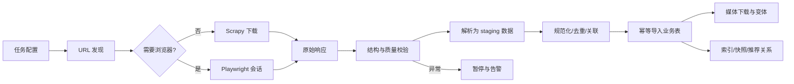

# 爬虫与数据导入

## 1. 目标

- 支持选择二级或三级类目后抓取该范围内商品；
- 支持设置商品条数、排序、评价目标数、市场和语言；
- 支持试点抓取、全站抓取、增量同步和完整刷新；
- 支持断点续爬、幂等导入、媒体下载和数据质量告警；
- 遵守授权范围、速率限制和网站风控，不绕过验证码或保护措施。

## 2. 分阶段策略

1. 选择 3-5 个类目；
2. 每类抓取 50-100 个商品；
3. 验证字段、SKU、图片、评价、去重、增量和重放；
4. 通过质量闸门后逐步扩大类目；
5. 最后才运行全站任务。

全站模式默认每件商品目标 50 条评价；指定类目或商品可设 `1-300`。真实评价不足时只保存实际数据。

## 3. 抓取技术

- 优先调用页面实际使用、且授权允许访问的数据接口；
- Scrapy 负责 URL 队列、限速、缓存、重试、去重和下载；
- Playwright 仅用于必须执行 JavaScript、建立登录会话或完成管理员人工验证的页面；
- Celery 负责任务编排和状态；
- 浏览器 worker 与 HTTP worker 分开；
- 解析器按页面类型和结构版本组织；
- 导入使用 staging 表或导入服务，不直接在 spider 内散写业务表。

## 4. 类目任务参数

> 2026-11-03 起的品类配额与树形选择改造，以
> [爬虫任务品类与配额页面改造方案](./09-crawler-category-task-redesign.md)
> 为最新设计基线。现有单类目参数保留用于历史任务兼容。

- 每次抓取必须显式保存 `source_locale`；后续中文类目分析使用 Joybuy 简体中文页面，英文现场结果只作历史参考；
- 每个实际支持的市场/语言组合独立抓取 Joybuy 页面并保存原样文本；德国页面出现德英混合时逐字段记录实际语言，不强制翻译，也不要求用户触发翻译；

管理端任务至少包含：

- 任务名称和优先级；
- 市场、语言、币种；
- 来源二级/三级类目；
- `仅当前类目` / `包含子类目`；
- 二级类目默认包含子类目，三级类目默认仅当前类目；
- 商品数量上限（新页面改名为“本任务最多成功入库商品数”，按去重且通过质量闸门的成功入库商品计数，不按请求数、页面数或发现链接数计数）；
- 排序：来源默认、销量、评分、新品、随机；
- 默认来源排序，并保存当时榜单位置；
- 模式：增量同步 / 完整刷新；
- 评价目标数 `1-300`，默认 50；
- 是否下载商品媒体、评价媒体和详情媒体；
- 调度时间、并发、速率和账号组；
- 失败策略和是否允许人工恢复。

随机抽样必须保存 seed，使重复任务可复现。

## 5. 增量与刷新

### 5.1 增量同步

- 发现新商品；
- 更新变化字段；
- 增量抓取新评价；
- 媒体 URL 或内容哈希变化时才重新下载；
- 已有商品不会因本次限量任务未出现而失效。

### 5.2 完整刷新

- 重新遍历任务范围；
- 更新现有数据并新增商品；
- 本轮未出现的来源 Offer 标记为疑似失效；
- 经连续确认后改为失效，不直接物理删除；
- 不覆盖本地人工覆盖值。

## 6. 建议频率

- 价格与来源库存状态：每 6 小时；
- 商品基础信息：每日；
- 评价：每日增量；
- 类目与品牌：每周；
- 媒体：内容变化触发；
- 所有频率可在管理端调整。

## 7. 多账号与会话

### 7.1 安全存储

- 使用用户提供且有权使用的 Facebook 账号手动完成 Joybuy OAuth；
- 系统不收集或保存 Facebook 密码；
- 只保存加密后的 Joybuy 会话；
- 会话失效后由管理员重新手动登录；
- 凭据不进入普通配置文件、错误日志或任务导出。

### 7.2 调度规则

- 每个账号有独立速率、并发和任务分区；
- 账号池还有全局总速率上限；
- 账号不得用来突破全局速率或绕过保护措施；
- 任一账号触发验证码/风控后立即移出队列；
- 被中断任务不能自动切换其他账号接管；
- 其他账号只能继续各自已经分配的独立任务；
- 短时间多个账号出现相同风险时全局熔断；
- 恢复必须经过人工验证与审核。

## 8. 限速、退避与缓存

- 域名级、接口级、账号级和全局四层限速；
- 429、403、5xx 使用带抖动的指数退避；
- 尊重服务端 Retry-After；
- 相同请求在有效期内使用缓存；
- URL、source ID、响应哈希和媒体哈希多层去重；
- 不为提高吞吐量轮换账号、代理或指纹；
- 风控页面不得作为正常商品页面解析。

具体速率不在代码中写死，应按授权配额配置并记录变更。

## 9. 数据流水线

### 9.1 价格采集口径（2026-11-03 需求）

- 爬虫只采集原价：商品详情页同时出现优惠价（current）与原价（list）时，以原价为准入库，优惠价被丢弃；
- 详情解析契约 `product_detail.py` 把原价写入 `current_price`，`list_price` 恒为 `None`，不保存优惠拆分；
- SKU 的 `data-price` 属于展示优惠价：页面存在原价时所有 SKU 价格统一归一为原价；页面没有原价时，页面唯一价格视为原价，SKU 各自价格保留；
- 商城端只展示该原价，展示层规则（美元符号、不渲染"今日送达"类标签）见 `docs/06-api-and-workflows.md` 第 6 节。

## 10. 评价采样

- 根据商品 ID 和任务 seed 生成确定性目标；
- 保持来源星级分布；
- 优先保证近期评价覆盖；
- 提高带图片/视频评价的覆盖，但不伪造其占比；
- 保存来源分页位置、排序、采样参数和抓取时间；
- 同一来源评价通过稳定 ID 或内容指纹去重；
- 评论媒体与商品媒体分目录保存。

## 11. 质量闸门

每类页面定义：

- 结构版本；
- 必填字段；
- 类型、长度和取值范围；
- 样例响应与解析契约测试；
- 核心字段缺失率阈值；
- 价格、SKU 数、媒体数和评价数异常阈值。

若标题、价格、SKU、主图等核心字段缺失率超过阈值：

1. 暂停任务；
2. 保留原始响应；
3. 告警并标记疑似页面改版；
4. 禁止异常批次覆盖已有数据；
5. 修复解析器并重放原始响应；
6. 通过抽样审核后恢复。

## 12. 原始数据与追溯

- 原始 HTML/JSON 默认保留 30 天；
- 规范化数据、媒体、来源哈希和任务记录长期保留；
- 每个字段尽量记录来源 URL、抓取时间和解析器版本；
- 排名必须记录榜单上下文；
- 来源没有展示的销量、排名等字段保持为空；
- 任何估算值使用独立字段和算法版本。

## 13. 站点快照

实施开始时建立页面与数据基线：

- 页面 URL 与类型；
- 桌面/移动截图；
- DOM 摘要与关键选择器；
- 接口请求/响应样例；
- 国家、语言、货币选项；
- 图标、字体和媒体清单；
- 当前规则说明和抓取日期。

Joybuy 后续变更先进入差异报告，不直接改变当前复刻版本。

