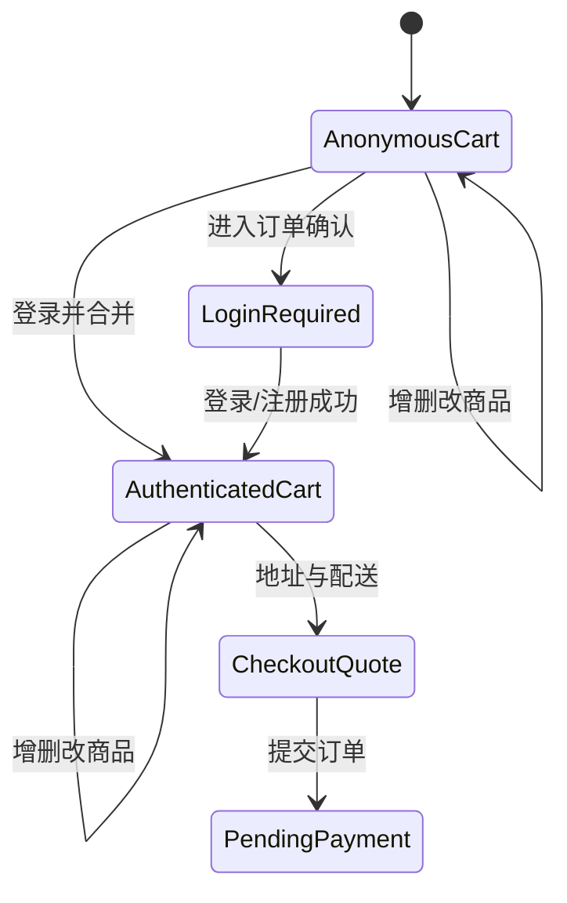
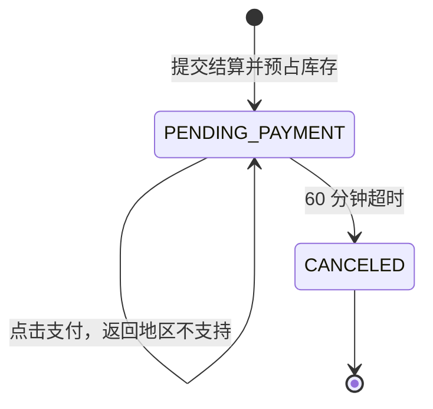

# API 与业务流程

## 1. API 原则

- 基础路径：`/api/v1/`；
- JSON 使用稳定字段名和明确的错误码；
- 列表使用游标或稳定键分页，大表禁止无界 OFFSET；
- 写操作支持幂等键；
- OpenAPI 文档与实现同版本；
- 管理 API 和购物 API 使用不同 namespace 与权限；
- 时间使用 ISO 8601 UTC；金额返回数值字符串、币种和格式化展示值。

## 2. 主要 API 域

### 2.1 购物端

```text
/api/v1/storefront/config
/api/v1/storefront/navigation
/api/v1/categories
/api/v1/search
/api/v1/products/{id}
/api/v1/products/{id}/reviews
/api/v1/products/{id}/recommendations
/api/v1/auth/buyer/*
/api/v1/buyer/profile
/api/v1/buyer/addresses
/api/v1/cart
/api/v1/cart/items
/api/v1/checkout/quote
/api/v1/orders
/api/v1/orders/{id}
/api/v1/orders/{id}/payment-attempt
/api/v1/notifications
```

### 2.2 平台端

```text
/api/v1/admin/auth/*
/api/v1/admin/buyers
/api/v1/admin/staff
/api/v1/admin/merchants
/api/v1/admin/categories
/api/v1/admin/catalog/*
/api/v1/admin/offers
/api/v1/admin/reviews
/api/v1/admin/media
/api/v1/admin/content/*
/api/v1/admin/orders
/api/v1/admin/crawlers/accounts
/api/v1/admin/crawlers/jobs
/api/v1/admin/crawlers/runs
/api/v1/admin/audit-logs
/api/v1/admin/system-config
```

商家 API namespace 可以预留，但在商家参考网页和功能需求确认前不承诺端点。

## 3. 购物车流程



规则：

- 游客可以浏览和维护临时购物车；
- 正式提交订单前必须登录；
- 合并购物车时按 SKU/Offer 合并数量并重新校验价格和库存；
- 购物车只保存当前选择，不冻结价格和库存；
- Checkout Quote 返回服务端计算的商品金额、运费和总额。

## 4. 订单与支付不可用流程



### 4.1 创建订单

同一数据库事务中：

1. 锁定并重新读取 Offer；
2. 校验商品状态和库存；
3. 计算价格和运费；
4. 创建订单与订单行快照；
5. 创建库存预占和库存流水；
6. 设置 `payment_expires_at = created_at + 60 minutes`；
7. 提交事务。

订单行必须保存标题、SKU 属性、图片、单价、币种和商家快照，避免商品后续变化破坏历史订单。

### 4.2 点击支付

- API 返回稳定业务错误 `PAYMENT_REGION_UNSUPPORTED`；
- 前端显示“当前地区暂不支持”；
- 不创建支付交易、不改变订单状态；
- 点击可记录技术日志，但首期不建设经营分析。

### 4.3 超时取消

- Celery 周期任务扫描已过期待支付订单；
- 使用行锁和幂等键防止重复释放；
- 状态改为 `CANCELED`；
- 释放库存预占并写流水；
- 发送站内/邮件通知（按配置启用）。

## 5. 库存显示

- 导入商品初始本地数量为 `9999`；
- 前端数量达到 999 或以上显示 `999+`；
- 下单预占会实际扣减可用库存；
- 取消订单释放库存；
- 平台可修改库存，但必须写库存调整流水和审计原因。

## 6. 价格与优惠

首期：

- 爬虫只采集原价：来源页同时出现优惠价与原价时，原价覆盖优惠价入库，优惠价与划线价拆分不保存（2026-11-03 需求）；
- 商城端所有商品只展示单一原价，不渲染划线价；
- 商城端所有价格一律以美元 `$` 符号展示，符号属于展示层规则，不改动存储币种（2026-11-03 需求）；
- 展示层不渲染"今日送达"类配送预估标签，来源促销标签在渲染时按配送预估关键词过滤（2026-11-03 需求）；
- 购物车和订单使用当前有效售价（即原价）；
- 订单保存价格快照；
- 运费通过可配置英国规则计算；
- 不执行优惠券、积分、JoyPlus、礼品卡和复杂叠加；
- 页面不得把未执行的优惠计入应付金额。

## 7. 认证

- 邮箱和手机号注册登录；
- 邮件/短信验证码在生产环境真实发送；
- 开发环境使用安全测试通道；
- 验证码有有效期、重发间隔、IP/账号限流和失败锁定；
- Facebook、Google 第二阶段；Apple 远期；
- 买家和员工会话完全隔离；
- 平台管理员强制 TOTP。

## 8. 通知与客服

- 统一消息中心覆盖订单、账户安全和系统通知；
- 支持站内信、邮件和短信模板；
- 短信默认只用于验证码和重要状态；
- 首期不建设客服聊天和工单；
- 页面只提供第三方客服占位入口；
- 未来第三方客服通过适配器获取有限的订单/商品上下文。

## 9. 平台管理流程

### 9.1 来源数据审核

1. 爬虫数据进入来源层；
2. 质量校验通过后更新当前来源值；
3. 本地覆盖值保持不变；
4. 后台展示差异；
5. 管理员可接受来源值、保留覆盖或清除覆盖；
6. 所有操作写审计日志。

### 9.2 商家与商品

- 商家可申请入驻或由平台创建；
- 首期只实现平台侧基础资料和状态；
- SPU 公共资料和受监管类目变更需要平台审核；
- 具体商家工作台和发布流程等待后续参考网页。

## 10. 错误码示例

```text
AUTH_REQUIRED
VERIFICATION_CODE_INVALID
PRODUCT_NOT_AVAILABLE
SKU_NOT_AVAILABLE
INSUFFICIENT_STOCK
PRICE_CHANGED
CART_ITEM_INVALID
ADDRESS_UNSUPPORTED
PAYMENT_REGION_UNSUPPORTED
ORDER_EXPIRED
CRAWL_JOB_PAUSED_RISK_CONTROL
CRAWL_SCHEMA_MISMATCH
```

错误响应必须包含 request ID，后台日志不得包含验证码、密码、完整 Cookie 或 OAuth 令牌。

